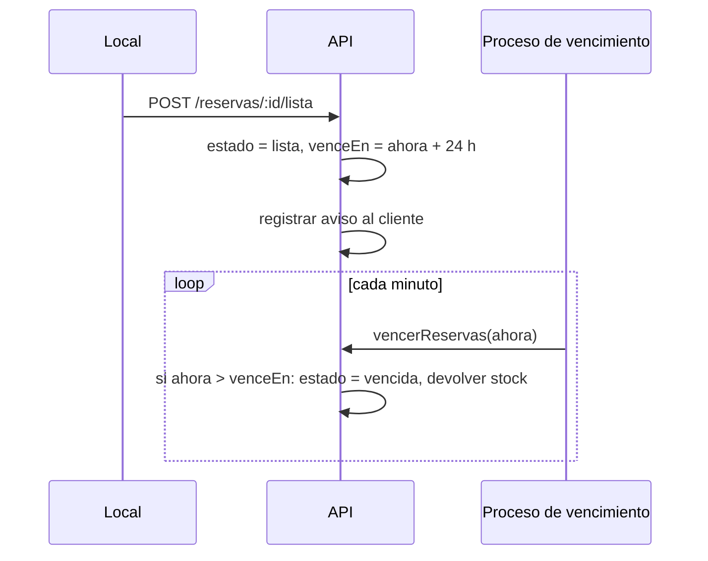

# Design Document — Reservas que expiran a las 24 horas

> Solución de referencia del Lab 1.

## Overview

Se agregan estados y fechas a la reserva, un proceso que vence reservas y libera stock, y un endpoint de consulta por local. Todo sigue en memoria, como el resto de la API.

## Modelo de datos

```ts
type EstadoReserva = 'activa' | 'lista' | 'retirada' | 'cancelada' | 'vencida';

interface Reserva {
  id: string;
  sku: string;
  idLocal: string;
  cantidad: number;
  cliente: { nombre: string; email: string };
  estado: EstadoReserva;
  creadaEn: string;   // ISO
  listaEn?: string;   // ISO, cuando pasa a 'lista'
  venceEn?: string;   // ISO, listaEn + 24 h (o cierre del día para cadena de frío)
  vencidaEn?: string; // ISO
}

interface Aviso { idReserva: string; email: string; mensaje: string; creadoEn: string }
```

## Componentes

| Componente | Responsabilidad |
| --- | --- |
| `src/services/vencimiento.ts` | `vencerReservas(ahora: Date)`: recorre reservas `lista`, vence las que pasaron `venceEn` y devuelve el stock |
| `src/services/avisos.ts` | Registra avisos en memoria (en producción sería un servicio de notificaciones) |
| `src/routes/reservas.ts` | `POST /reservas/:id/lista` marca la reserva como lista y calcula `venceEn` |
| `src/routes/locales.ts` | `GET /locales/:id/reservas-vencidas?desde=&hasta=` |
| `src/server.ts` | Programa `vencerReservas` cada minuto con `setInterval` |

## Flujo



## Manejo de errores

Todos los errores usan el formato `{ error: { code, message } }` definido en el steering de API.

## Estrategia de pruebas

- Pruebas unitarias de `vencerReservas` inyectando la fecha actual (sin esperar 24 horas reales).
- Pruebas de API con Supertest para el nuevo endpoint y el cambio de estado.
- Caso límite: una reserva retirada justo antes de vencer no debe vencer.
